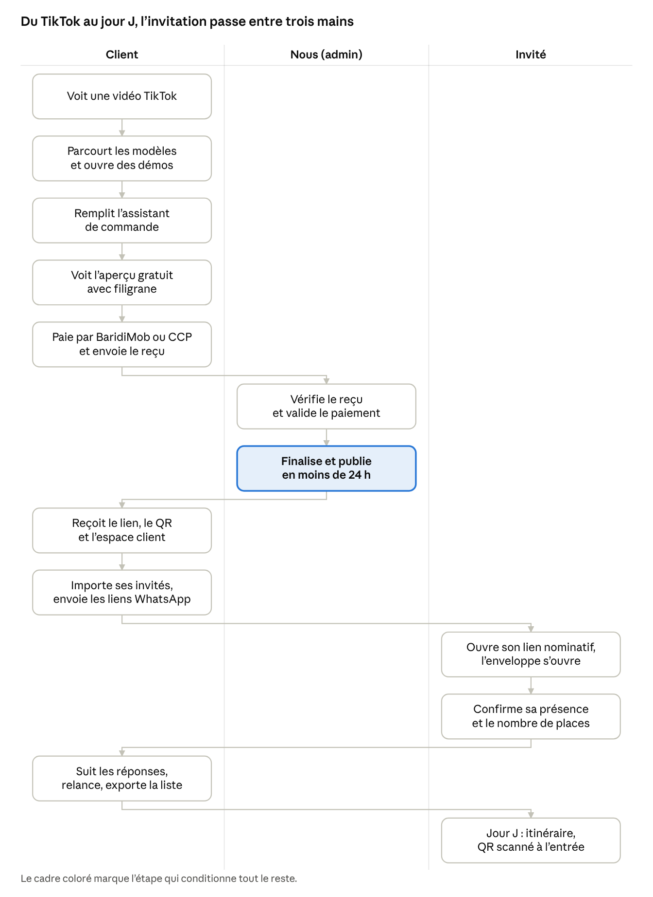

# App Flow

Comment on passe d'un écran à l'autre, pour chaque type d'utilisateur : visiteur, client, invité et admin.

## Vue d'ensemble

Le client fait tout seul jusqu'au paiement ; notre seule intervention est la vérification et la publication, qui débloquent l'espace client et les liens des invités.

## Plan du site

37 écrans répartis en quatre espaces. Chaque page publique existe en `/fr` et `/ar`.

| Espace | Écran | URL | Qui | Priorité |
| --- | --- | --- | --- | --- |
| Site public | Accueil (héro 3D, comment ça marche, modèles phares, avis, FAQ courte) | `/[lang]` | Tout le monde | MVP |
| Site public | Catalogue avec filtres (événement, style, pack) | `/[lang]/modeles` | Tout le monde | MVP |
| Site public | Page catégorie (mariage, anniversaire…) | `/[lang]/modeles/c/[evenement]` | Tout le monde | MVP |
| Site public | Fiche modèle + démo dans un téléphone | `/[lang]/modeles/[slug]` | Tout le monde | MVP |
| Site public | Démo plein écran | `/demo/[slug]` | Tout le monde | MVP |
| Site public | Tarifs | `/[lang]/tarifs` | Tout le monde | MVP |
| Site public | Avis | `/[lang]/avis` | Tout le monde | MVP |
| Site public | FAQ | `/[lang]/faq` | Tout le monde | MVP |
| Site public | Contact | `/[lang]/contact` | Tout le monde | MVP |
| Site public | Pages légales (CGV, confidentialité, remboursement) | `/[lang]/legal/[page]` | Tout le monde | MVP |
| Site public | Entreprises, Partenaires, Blog | `/[lang]/entreprises` `/partenaires` `/blog` | Tout le monde | V2 |
| Commande | Assistant : étape 1 événement → 2 noms → 3 dates et lieux → 4 textes → 5 photos et musique → 6 options | `/[lang]/commander` | Visiteur | MVP |
| Commande | Aperçu avec filigrane | `/[lang]/commander/apercu` | Visiteur | MVP |
| Commande | Choix du pack et récapitulatif | `/[lang]/commander/pack` | Visiteur | MVP |
| Commande | Paiement : RIP CCP / BaridiMob + envoi du reçu (V2 : Edahabia/CIB) | `/[lang]/commander/paiement` | Visiteur | MVP |
| Commande | Confirmation + code de suivi | `/[lang]/commander/merci` | Visiteur | MVP |
| Commande | Suivi de commande par code | `/[lang]/suivi` | Visiteur | MVP |
| Invitation | Ouverture animée + invitation | `/i/[slug]` | Invité | MVP |
| Invitation | Invitation nominative (« Cher Karim », places) | `/i/[slug]/[code]` | Invité | MVP |
| Invitation | Confirmation RSVP envoyée | (dans la page) | Invité | MVP |
| Invitation | Code d'accès (invitation protégée) | `/i/[slug]/acces` | Invité | MVP |
| Invitation | Invitation expirée / événement passé (merci + livre d'or) | `/i/[slug]` | Invité | MVP |
| Invitation | « Trouver ma table » | `/i/[slug]/table` | Invité | V2 |
| Espace client | Connexion par lien magique | `/[lang]/connexion` | Client | MVP |
| Espace client | Mes invitations | `/compte` | Client | MVP |
| Espace client | Modifier l'invitation (aperçu en direct) | `/compte/invitations/[id]` | Client | MVP |
| Espace client | Invités : liste, import, liens, envoi WhatsApp | `/compte/invitations/[id]/invites` | Client | MVP |
| Espace client | Réponses RSVP + export | `/compte/invitations/[id]/reponses` | Client | MVP |
| Espace client | Livre d'or (modération) | `/compte/invitations/[id]/voeux` | Client | MVP |
| Espace client | Scanner les QR à l'entrée | `/compte/invitations/[id]/scan` | Client | V2 |
| Admin | Tableau de bord | `/admin` | Admin | MVP |
| Admin | Commandes (liste, détail, statuts) | `/admin/commandes` | Admin | MVP |
| Admin | Paiements à vérifier | `/admin/paiements` | Admin | MVP |
| Admin | Modèles | `/admin/modeles` | Admin | MVP |
| Admin | Clients | `/admin/clients` | Admin | MVP |
| Admin | Bibliothèque (musiques, versets, illustrations) | `/admin/bibliotheque` | Admin | MVP |
| Admin | Promos et partenaires, avis | `/admin/promos` `/admin/avis` | Admin | V2 |

## Parcours détaillés

**1. Commande (visiteur → client)**

1. Accueil ou lien TikTok → bouton « Voir les modèles » → Catalogue.
2. Catalogue → filtre « Mariage » → touche une carte → Fiche modèle (démo jouable dans un téléphone).
3. Fiche modèle → « Personnaliser ce modèle » → Assistant, modèle déjà choisi. Sans modèle : « Je ne sais pas encore » ouvre l'assistant et propose 3 modèles à la fin.
4. Assistant (6 étapes, barre de progression, retour possible, brouillon gardé sur le téléphone) → Aperçu avec filigrane, sur le téléphone du client.
5. Aperçu → « Modifier » (retour à l'étape voulue) ou « Choisir mon pack » → Pack → Paiement.
6. Paiement → envoi de la photo du reçu + numéro WhatsApp → Merci (code de suivi, bouton WhatsApp).
7. Admin valide le paiement → e-mail et WhatsApp au client avec le lien de connexion à l'espace client.

**2. Invité**

1. WhatsApp → aperçu du lien (image + titre) → ouvre `/i/[slug]/[code]`.
2. Écran d'ouverture (prénom de l'invité visible) → touche → animation + musique + bouton son.
3. Premier écran : noms, date, heure, lieu, bouton « Je confirme » toujours visible en bas.
4. RSVP : présent / absent → nombre de places (limité par le lien) → message → Envoyer → confirmation + youyous + « Ajouter au calendrier ».
5. Revenir plus tard sur le même lien : la réponse est rappelée et modifiable jusqu'à la date limite.
6. Jour J : itinéraire, QR d'entrée (Prestige), disponibles même sans réseau.

**3. Espace client**

1. Lien magique reçu par e-mail (ou transmis à la main par nous sur WhatsApp) → Mes invitations.
2. Invitation → onglets : Modifier, Invités, Réponses, Vœux (Scan en V2).
3. Invités → « Importer » (Excel/CSV, aperçu avant validation) ou « Ajouter » → chaque ligne a « Envoyer sur WhatsApp » (message pré-rédigé FR/AR avec le lien nominatif).
4. Réponses → compteurs (présents, absents, sans réponse, total de personnes) → filtre « sans réponse » → relance WhatsApp → export Excel/PDF.

**4. Admin**

1. Tableau de bord → carte « 3 paiements à vérifier » → Paiements.
2. Paiement → photo du reçu + montant attendu → « Valider » ou « Refuser (motif) » → la commande passe à « Payée ».
3. Commande → « M'assigner » → finaliser l'invitation (même éditeur que le client, plus les options admin) → « Publier » → le filigrane disparaît, le client reçoit son lien.
4. Modèles → ajouter / masquer un modèle, image d'aperçu, tags, prix.

## États et cas limites

Chaque écran doit prévoir ses états vides, d'attente et d'erreur, en FR et AR.

| Situation | Ce que voit l'utilisateur |
| --- | --- |
| Connexion lente | Squelettes gris à la place du contenu, l'ouverture d'invitation reste jouable sans la musique |
| Pas de réseau (invitation déjà ouverte) | Version enregistrée : noms, date, lieu, programme, QR ; le RSVP est envoyé au retour du réseau |
| Lien d'invité inconnu ou modifié | « Ce lien n'est pas valide. Demandez à la famille de vous le renvoyer. » + version générique si le client l'autorise |
| Places dépassées | Le compteur s'arrête au maximum du lien, avec « Votre invitation est prévue pour 4 personnes » |
| Date limite RSVP passée | « Les réponses sont closes. Contactez la famille. » + bouton appeler |
| Événement passé | Message de remerciement, livre d'or ouvert, RSVP fermé |
| Invitation non payée | Filigrane « Aperçu », RSVP désactivé |
| Liste d'invités vide | « Ajoutez vos premiers invités » + boutons Importer / Ajouter + modèle Excel |
| Aucune réponse encore | « Les réponses apparaîtront ici dès qu'un invité confirme. » |
| Import Excel avec erreurs | Aperçu ligne par ligne, lignes fautives en rouge avec la raison, import des lignes valides seulement |
| Reçu illisible ou montant faux | Statut « Paiement refusé » + motif + bouton renvoyer un reçu |
| Erreur serveur | « Quelque chose n'a pas marché. Réessayez dans un instant. » + bouton WhatsApp support |
