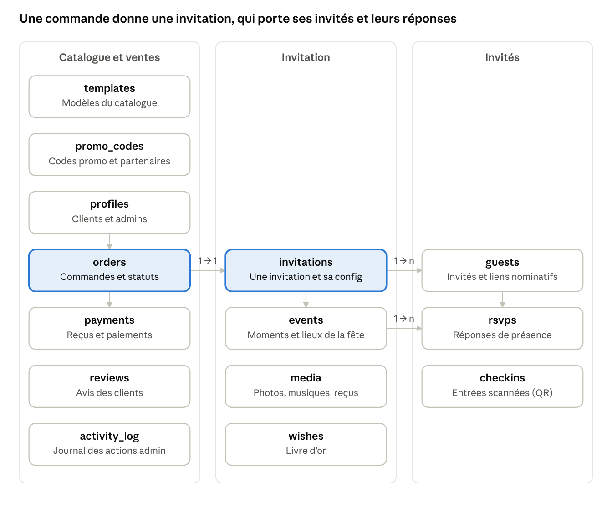

# Backend Schema

La base de données Cloudflare D1 (SQLite) : tables, liens, index, règles d'accès, et le code prêt à copier dans le projet.

## Les tables et leurs liens



Les deux tables encadrées portent tout le produit : une commande (`orders`) crée exactement une invitation (`invitations`). Autres liens non dessinés : `templates` → `orders` et `invitations`, `orders` → `reviews`, `guests` → `checkins`, `invitations` → `media` et `wishes`. Supprimer une commande efface son invitation, ses invités et leurs réponses ; un modèle déjà vendu ne peut pas être supprimé (on le masque).

## Tables

Conventions : identifiants UUID en texte, dates en millisecondes, montants entiers en DA, textes traduits en JSON `{ fr, ar }`. Les tables de connexion (user, session, account, verification) sont générées par Better Auth.

| Table | Champs clés | Contraintes et index |
| --- | --- | --- |
| profiles | user\_id, full\_name, phone, whatsapp, locale, role (client / admin), partner\_code\_id | user\_id unique ; index sur role |
| templates | slug, name (FR/AR), event\_types, style, tags, preview\_image, base\_price\_da, min\_pack, badges, is\_active, sort\_order | slug unique ; index (is\_active, sort\_order) |
| promo\_codes | code, kind (pourcentage / montant), value, partner\_name, commission\_percent, max\_uses, used\_count, expires\_at | code unique |
| orders | tracking\_code, customer\_id, contact\_name, contact\_whatsapp, template\_id, pack, options, amount\_da, discount\_da, status, assigned\_to, source, due\_at, delivered\_at | tracking\_code unique ; statut, pack et montants contrôlés ; index (status, created\_at), client, assigné ; un modèle vendu ne peut pas être supprimé |
| payments | order\_id, method, amount\_da, receipt\_key, provider\_ref, status, refusal\_reason, validated\_by | provider\_ref unique (un paiement Chargily n'est jamais compté deux fois) ; méthode, statut contrôlés ; montant > 0 |
| invitations | order\_id, owner\_id, template\_id, slug, event\_type, config (JSON), languages, discreet\_mode, access\_code\_hash, rsvp\_open, rsvp\_deadline, music\_key, is\_published, expires\_at, view\_count | order\_id et slug uniques ; index sur owner et expires\_at (purge) |
| events | invitation\_id, type (cérémonie, henné, fête femmes, fête hommes, cortège, dîner…), title, starts\_at, ends\_at, venue\_name, address, lat, lng, maps\_url | index (invitation, ordre) ; type contrôlé |
| guests | invitation\_id, name, phone, group\_label, max\_seats, code, allowed\_event\_ids, table\_label, sent\_at, first\_opened\_at, open\_count | code unique (lien et QR) ; places entre 1 et 50 |
| rsvps | invitation\_id, guest\_id, event\_id, name, answer (oui / non / peut\_être), seats, message, source (lien / manuel) | une seule réponse par invité et par moment de la fête ; plusieurs réponses possibles sur le lien générique |
| checkins | guest\_id, event\_id, scanned\_by, seats\_in | un seul scan par invité et par moment |
| wishes | invitation\_id, guest\_id, name, message, audio\_key, is\_approved | index (invitation, date) |
| media | owner\_id, invitation\_id, kind (photo, musique, vidéo, reçu, audio), r2\_key, mime\_type, size\_bytes | r2\_key unique |
| reviews | order\_id, rating, text, screenshot\_key, consent\_to\_publish, is\_published | une par commande ; note de 1 à 5 |
| activity\_log | actor\_id, action, entity, entity\_id, details | index (entity, entity\_id) |

## Le code du schéma

Trois fichiers prêts à copier, envoyés dans la conversation : `schema.ts` (525 lignes, à mettre dans `src/db/`), `0000_init.sql` (la migration générée, dans `drizzle/`) et `drizzle.config.ts` (à la racine).

**Ce qui a été testé** (TypeScript strict, Drizzle ORM 0.44, drizzle-kit 0.31, migration appliquée sur une vraie base SQLite) :

- [x] Le schéma compile sans erreur et la migration crée les 14 tables.
- [x] Un invité ne peut pas répondre deux fois, ni au global ni pour le même moment (henné, fête des femmes…).
- [x] Un invité peut répondre séparément au henné et à la fête des femmes.
- [x] Le lien générique accepte plusieurs réponses.
- [x] Statut, réponse, type d'événement inventés : refusés par la base.
- [x] Note hors 1–5, 0 place, paiement de 0 DA, code d'invité en double : refusés.
- [x] Modèle déjà commandé : suppression refusée.
- [x] Commande supprimée : invitation, invités et réponses supprimés avec elle.

**Mise en place dans le projet**

```bash
pnpm add drizzle-orm
pnpm add -D drizzle-kit
# tables de connexion Better Auth
npx @better-auth/cli generate --output src/db/auth-schema.ts
# migration locale puis en ligne (base D1 nommée "louloua-db" dans wrangler.jsonc)
npx wrangler d1 migrations apply louloua-db --local
npx wrangler d1 migrations apply louloua-db --remote
```

Pour Wrangler, `drizzle.config.ts` doit pointer `out` vers le dossier de migrations déclaré dans `wrangler.jsonc` (`migrations_dir`). Claude Code fait ce réglage en phase 0.

## Règles d'accès et de rétention

D1 n'a pas de règles d'accès intégrées : chaque requête serveur vérifie qui a le droit de faire quoi.

| Qui | Peut lire | Peut écrire |
| --- | --- | --- |
| Visiteur | templates actifs, invitations publiées (sans la liste des invités) | orders (création), payments (reçu de sa commande via le code de suivi) |
| Invité (code du lien) | son invitation, ses events, sa propre fiche guest et sa réponse | sa réponse rsvps (jusqu'à la date limite), wishes |
| Client connecté | ses orders, invitations, events, guests, rsvps, wishes, media | ses invitations (config), guests, rsvps manuelles, modération des wishes, checkins |
| Admin | tout | tout ; chaque action sensible écrit une ligne dans activity\_log |

**Rétention**

- `invitations.expires_at` = date du dernier événement + 6 mois. Une tâche planifiée (Cron Cloudflare, chaque nuit) supprime alors guests, rsvps, checkins, wishes, media et fichiers R2 de l'invitation.
- Commandes, paiements et avis restent pour la comptabilité, sans les données des invités.
- Le client peut demander la suppression immédiate depuis son espace.
